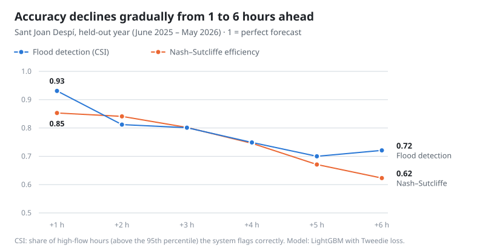
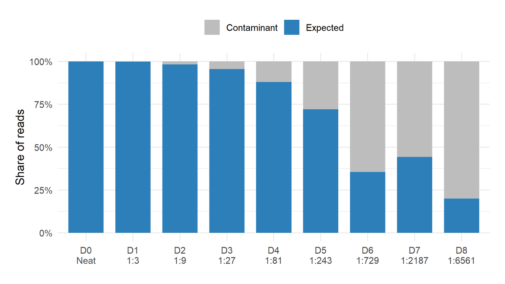
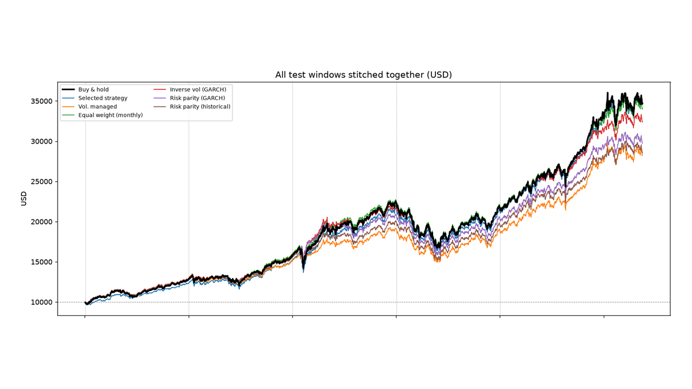
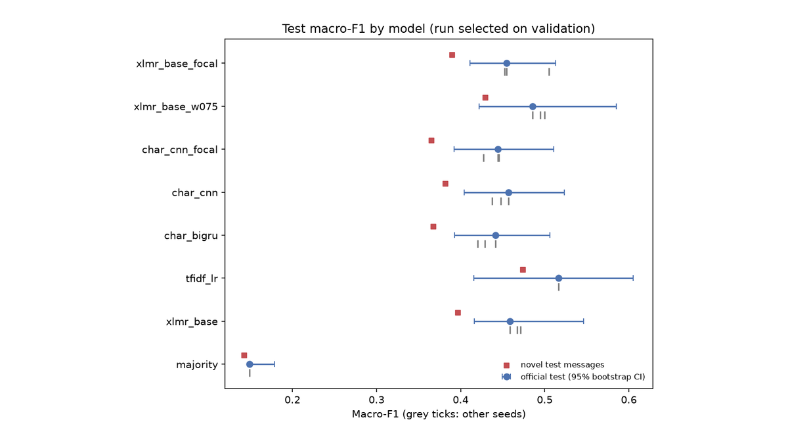
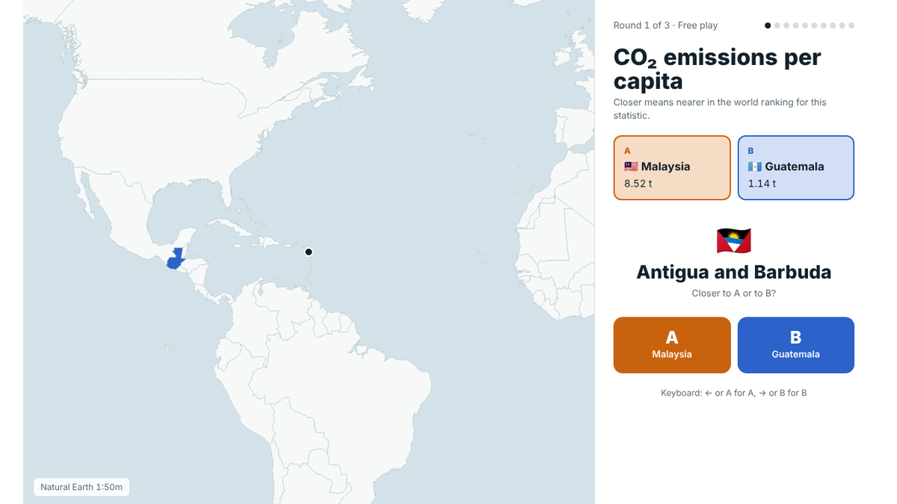
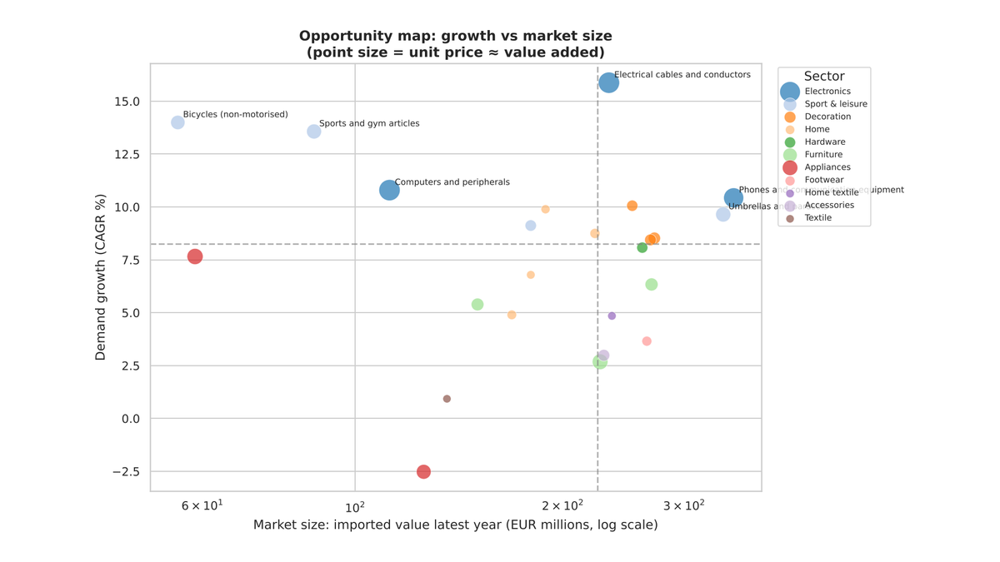
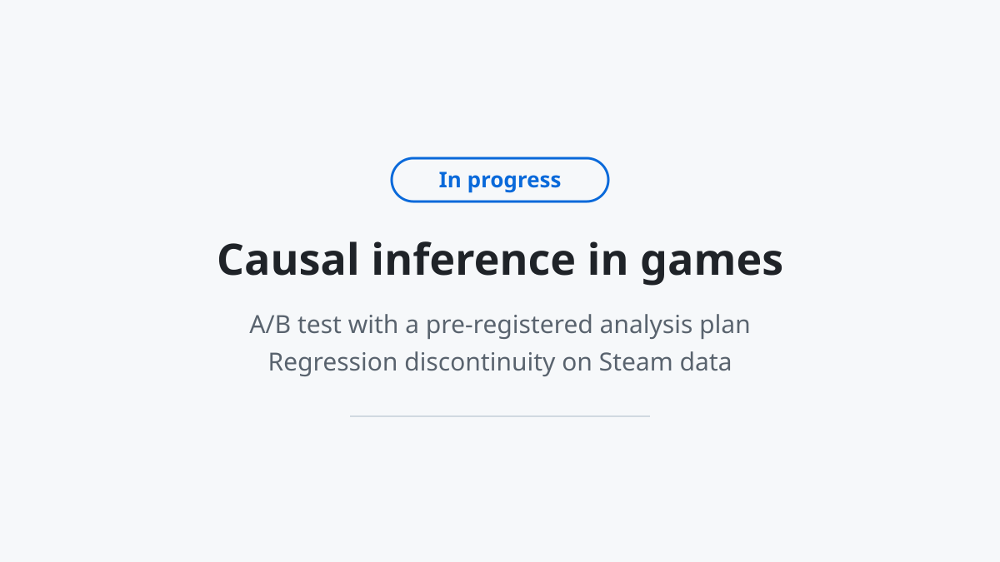

<picture>
  <source media="(prefers-color-scheme: dark)" srcset="assets/header-dark.svg">
  
</picture>

  
  
  
  

I build forecasting models, biostatistical analyses and machine-learning systems, and I care
most about the part that usually gets skipped: **checking whether the result holds up.**

I'm a research assistant in the Statistics section of the University of Barcelona, working on
machine-learning flood forecasting, and I'm doing the MSc in Data Science at the UOC. Before
that I spent seven years as a financial data and tax advisor, so I'm used to messy real-world
data, deadlines and people who need a clear answer rather than a model.

**How I work**

- **The baseline is the null hypothesis.** A model counts only if it beats a simple alternative out of sample.
- **Uncertainty is part of the result.** Intervals, seed variability, simulations and sensitivity checks.
- **Negative results get reported.** "The method does not work" is a finding, not a failure.
- **Reproducible by default.** Tests, CI, pinned environments and reports generated from code.

 

## Main project: flood forecasting on the Llobregat river

  
  
  
  
  

**Hourly streamflow forecasts and flood early warning, 1 to 6 hours ahead**, for a 4,948 km²
Mediterranean basin that floods suddenly: in the November 2024 DANA the river at Sant Joan
Despí rose from about 25 to 536 m³/s, just upstream of the plant that supplies drinking water
to much of Barcelona. The system runs live in the cloud and publishes its forecasts and alert
levels on a **[public forecast page](https://joangordo.github.io/llobregat-operatiu-tfg/?lang=en)**.

<picture>
  <source media="(prefers-color-scheme: dark)" srcset="assets/llobregat-skill-dark.svg">
  
</picture>

- **The loss function mattered more than the algorithm.** The same LightGBM with a squared
  loss was the worst model compared; with a Tweedie loss it was the best at almost every
  horizon.
- **Persistence is hard to beat, and I report it.** One hour ahead nothing beats repeating
  the current flow; from three hours on, the model cuts persistence's error by about a
  quarter, which is when a warning is useful.
- **Better weather forecasts would not fix it.** Feeding the model the rain that actually
  fell did not consistently reduce the error.

A project of the **BIOST3** research group (University of Barcelona). I led the statistical
modelling and validation; **Àlex Rodríguez Molla** built the original operational system and web
platform, which I later moved to GitHub Actions
([code](https://github.com/joangordo/llobregat-operatiu-tfg)). Supervised by **Antonio
Monleón-Getino**, **Pere López Brosa** and **Javier Méndez-Viera**. First-author paper with all
of them in preparation for *Ingeniería del Agua*. **Now** I'm leading its extension to
basin-wide, multi-station prediction in Python.

<b>Full project summary: data, modelling, validation and results</b>

 

**Data.** 13 river gauges and 3 reservoirs from the Catalan Water Agency (ACA) and 30 rain
gauges from the Meteorological Service of Catalonia (Meteocat), 2019–2026, about 127,000
half-hourly records, used under each agency's reuse conditions. Gauge data are resampled
by taking the nearest reading rather than the mean, so flood peaks are not smoothed away.

**Modelling.** 341 candidate predictors (lags, rolling maxima, accumulated basin rainfall,
antecedent precipitation indices, reservoir volumes) reduced to 5–20 per horizon by backward
elimination on flood-period error. Eight models compared, from persistence and an
autoregressive baseline to direct and hybrid (residual) random forests and LightGBM, and a
LightGBM with a Tweedie loss whose power parameter is tuned per horizon.

**Validation.** Five-fold expanding-window temporal cross-validation, then a fully held-out
final year (June 2025 – May 2026) that the models never saw.

**Results at Sant Joan Despí (held-out year)**

| Lead time | +1 h | +2 h | +3 h | +4 h | +5 h | +6 h |
|---|---:|---:|---:|---:|---:|---:|
| Nash–Sutcliffe efficiency | 0.85 | 0.84 | 0.80 | 0.75 | 0.67 | 0.62 |
| Flood detection (CSI, flow > 95th percentile) | 0.93 | 0.81 | 0.80 | 0.75 | 0.70 | 0.72 |
| Skill vs persistence | −0.62 | 0.08 | 0.24 | 0.27 | 0.25 | 0.25 |

**The model learns the hydrology.** The current flow carries 75% of the importance at +2 h
and 43% at +6 h; accumulated basin rainfall and antecedent wetness take its place.

**Operational system.** Every 30 minutes, GitHub Actions downloads the latest ACA and
Meteocat data, builds the features, forecasts the six horizons and publishes a bilingual
[forecast page](https://joangordo.github.io/llobregat-operatiu-tfg/?lang=en). It is an experimental academic project, not an official warning
system.

**Next.** A model, features and hyperparameters per gauging station, more stations and
reservoirs, and the full ACA historical record.

 

## More projects

<table>
<tr>
<td width="50%" valign="top">

<h3><a href="https://github.com/joangordo/decontam-low-biomass">Contaminant removal in low-biomass 16S data</a></h3>

Benchmark on a public mock-community dilution series and a simulation study (48 scenarios × 20 studies), ending in a decision guide. An independent study on public data, prompted by my experience with low-biomass samples.

<b>Finding:</b> DNA quantification matters more than the method: 76% vs 8% of contamination removed.

<code>R</code> <code>Quarto</code> <code>testthat</code> <code>renv</code> · <a href="https://joangordo.github.io/decontam-low-biomass/">Read the reports</a>

</td>
<td width="50%" valign="top">

<h3><a href="https://github.com/joangordo/can-forecasts-beat-buy-and-hold">Can econometric forecasts beat buy &amp; hold?</a></h3>

Walk-forward backtest on four ETFs, 2010–2026, with buy &amp; hold as the null hypothesis: ARIMA, GARCH and VAR forecasts, direction classifiers and volatility-managed portfolios, after costs.

<b>Finding:</b> no strategy beats buy &amp; hold's Sharpe ratio after Holm correction.

<code>Python</code> <code>statsmodels</code> <code>arch</code> <code>pytest</code>

</td>
</tr>
<tr>
<td width="50%" valign="top">

<h3><a href="https://github.com/joangordo/game-chat-toxicity">Toxicity detection in game chat</a></h3>

Six-class detection on multilingual game chat, from TF-IDF to character-level networks written from scratch and a fine-tuned XLM-RoBERTa, then applied to another game without retraining.

<b>Finding:</b> the public benchmark cannot rank the models: 41% of test texts also appear in training.

<code>PyTorch</code> <code>Transformers</code> · <a href="https://huggingface.co/joangordo/game-chat-toxicity-xlmr">Model on Hugging Face</a>

</td>
<td width="50%" valign="top">

<h3><a href="https://github.com/joangordo/closer-geo">Closer</a></h3>

A geography game on open country statistics: is each country closer to A or to B? An explicit difficulty model, games reproducible from a seed, and a versioned data pipeline (195 countries, 10 indicators).

<b>Try it:</b> <a href="https://joangordo.github.io/closer-geo/">play in the browser</a>.

<code>JavaScript</code> <code>Python</code>

</td>
</tr>
<tr>
<td width="50%" valign="top">

<h3><a href="https://github.com/joangordo/trade-market-analysis">Import opportunity scoring</a></h3>

Which product categories are worth importing from China into Spain? An end-to-end pipeline on official Eurostat trade data, from API ingestion to a configurable scoring model.

<b>Finding:</b> a worked example of why a top-ranked category was a false positive.

<code>Python</code> <code>pandas</code> <code>REST APIs</code>

</td>
<td width="50%" valign="top">
<picture>
  <source media="(prefers-color-scheme: dark)" srcset="assets/causal-dark.svg">
  
</picture>
<h3>Causal inference in games</h3>

Analysis of a mobile-game A/B test with a pre-registered analysis plan, and a regression discontinuity design on Steam data.

<b>Status:</b> in progress.

<code>Python</code> <code>A/B testing</code> <code>RDD</code>

</td>
</tr>
</table>

 

## Experience

**Research Assistant, Statistics** · Dept. of Genetics, Microbiology and Statistics,
University of Barcelona · *Nov 2025 – present* 
Statistical and machine-learning models with reproducible pipelines in Python and R. Leading
the multi-station extension of the Llobregat flood-forecasting system and co-authoring its
results for peer-reviewed publication.

**Financial Data and Tax Advisor** · Assessoria 21 · Segurzon · *2019 – 2025* 
Managed and analysed financial and tax data for 60+ clients; built data models to detect
inconsistencies; turned complex regulation into clear reports for non-technical clients.

**Data Science Intern** · Vall d'Hebron Research Institute (VHIR) · *2018* 
Data cleaning and statistical analysis in a biomedical research setting, including 16S
microbiome data.

## Education

**MSc in Data Science** · Universitat Oberta de Catalunya (UOC) · *2026 – 2027* 
Electives: Deep Learning, Natural Language Processing

**BSc in Statistics** · Universitat de Barcelona / Universitat Politècnica de Catalunya · *2026* 
Thesis: machine learning for flood-risk prediction in the Llobregat basin

 

## Toolbox

  
  
  
  
  
  
  
  
  
  

  
  
  
  
  
  
  

**Methods:** regression and GLMs · time series (ARIMA, GARCH, VAR) · hypothesis testing and
multiple comparisons · bootstrap · simulation studies · Bayesian methods · A/B testing and
experimental design · causal inference · imbalanced data · temporal cross-validation ·
calibration

**Languages:** Catalan and Spanish (native) · English (C1, IELTS 7.0) · Mandarin (HSK 2 level,
studying toward HSK 4)

 

---

Open to data science, biostatistics and ML roles in Barcelona or remote, and to relocation. 
<a href="mailto:jgordoguardia@gmail.com">jgordoguardia@gmail.com</a> ·
<a href="https://www.linkedin.com/in/jgordoguardia/">LinkedIn</a>

